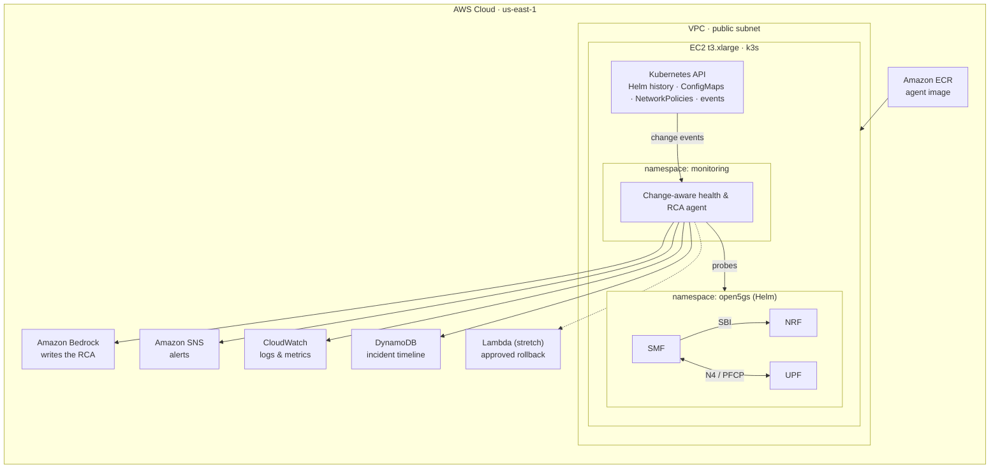

# Change-Aware Health Monitoring and RCA for a Cloud-Native 5G Core on AWS

**Cloud Engineer Bootcamp — Capstone Project** · Sandeep Kumar Gundlapalli

An open-source 5G Standalone core (Open5GS) running on Kubernetes in AWS, plus an AI agent that catches the 5G failures Kubernetes failover cannot fix, ties each failure to the change that caused it, and writes the root-cause analysis (RCA).

> **Status:** Design approved for review · Build not started · Next: AWS network + EC2 node via CloudFormation

---

## 1. The problem

In a cloud-native 5G SA core, the **SMF** (control plane) and **UPF** (user plane) run in separate pods and talk over the **N4 interface (PFCP)**. After an application upgrade or a configuration change, that link can break — and operators are often left with no alert and no RCA.

Kubernetes self-healing restarts crashed pods, but it does not cover these cases:

| Gap | What happens | Why failover doesn't help |
|---|---|---|
| **Gray failure** | Pod passes liveness/readiness probes, but the PFCP association or NRF registration is down | Kubernetes sees a healthy pod, so failover never triggers |
| **Change-induced failure** | Bad ConfigMap, Helm value, image tag or NetworkPolicy | The standby pod has the same bad config — failover moves the fault, it doesn't fix it |
| **Stateful recovery gap** | A replacement UPF must re-establish PFCP with the SMF | Nothing reports whether recovery worked or how long subscribers were affected |
| **Lost evidence** | Pod restarts discard the logs from the failure | The team sees "recovered" but never learns why it broke, so it repeats |

## 2. The solution

A **change-aware health and RCA agent** that runs inside the cluster and works in four steps:

1. **Detect** — 5G-layer checks: PFCP association (SMF↔UPF), NRF registration, SBI and N4 (UDP 8805) reachability, pod status.
2. **Correlate** — match each failure to recent changes: Helm revisions, ConfigMap edits, image tags, NetworkPolicy updates, pod restarts.
3. **Diagnose** — capture logs and Kubernetes events before they are lost; **Amazon Bedrock** turns them into a plain-language RCA.
4. **Recover and verify** — recommend (or, with approval, trigger) a rollback, confirm PFCP is re-associated, and record **time to detect** and **time to recover**.

The heartbeat checks are the sensor. The product is the RCA and a shorter time to recovery.

## 3. Architecture


*Editable source: [`docs/architecture.drawio`](docs/architecture.drawio) — built with the official AWS Architecture Icons in draw.io (diagrams.net).*

**How it flows**

1. The agent runs in its own namespace next to the Open5GS core and probes NRF, SMF and UPF over SBI and N4 (PFCP, UDP 8805).
2. It watches the Kubernetes API for changes: Helm releases, ConfigMaps, NetworkPolicies, pod restarts.
3. When a check fails, it captures logs and events, asks **Amazon Bedrock** for an RCA, alerts through **SNS**, records the incident in **DynamoDB** and publishes time-to-detect / time-to-recover metrics to **CloudWatch**.
4. *(Stretch)* An approved rollback runs through **AWS Lambda**. The node pulls the agent image from **ECR**, is reached through **Systems Manager Session Manager**, and is provisioned with **CloudFormation**.

<details>
<summary>Text version of the diagram (Mermaid)</summary>



</details>

## 4. AWS services

| Service | Role |
|---|---|
| VPC, subnet, Internet Gateway | Network for the cluster (public subnet, no NAT Gateway to keep cost low) |
| Security Groups | Allow only required traffic; no inbound SSH |
| EC2 (t3.xlarge) | Runs k3s, the 5G core pods and the agent |
| Systems Manager Session Manager | Shell access without SSH keys or a bastion |
| IAM roles | Least-privilege access for the agent to Bedrock, SNS, CloudWatch, DynamoDB |
| Amazon ECR | Stores the agent's container image |
| Amazon Bedrock | Generates the RCA from logs, events and change history |
| Amazon SNS | Email/SMS alerts carrying the RCA summary |
| Amazon CloudWatch | Logs, per-check metrics, time-to-detect / time-to-recover metrics, alarms |
| Amazon DynamoDB | Incident timeline: change → failure → RCA → recovery |
| Amazon EventBridge | Daily health report schedule, incident event routing |
| AWS CloudFormation | Infrastructure as Code for the AWS side |
| *Stretch:* Lambda / SSM Automation, EKS, S3 + CloudFront | Approved rollback, managed Kubernetes demo, health dashboard |

**Open-source components:** Open5GS (5G core), Helm, k3s (Kubernetes), UERANSIM (stretch: simulated gNB + UE).

## 5. Demo scenarios

| # | Scenario | What Kubernetes does | What the agent adds |
|---|---|---|---|
| 1 | Bad ConfigMap pushed (wrong UPF N4 address) | Nothing — pods stay Running | Detects lost PFCP association, links it to the config change, recommends `helm rollback` |
| 2 | NetworkPolicy blocks UDP 8805 | Nothing | Pinpoints the N4 path and the policy that changed |
| 3 | UPF pod deleted | Restarts it | Confirms PFCP re-associated, reports outage duration |
| 4 | *(stretch)* Bad image upgrade | Rolls out the bad version | Ties the failure to the new image tag, keeps logs from before the restart |

## 6. Scope

| | Minimum version | Stretch |
|---|---|---|
| 5G functions | NRF, SMF, UPF | + AMF, AUSF, UDM, UDR, PCF |
| Failure scenarios | #1, #2, #3 | #4, multiple UPFs |
| Agent action | Detect, correlate, Bedrock RCA, SNS alert | Approved rollback via Lambda/SSM |
| Records | CloudWatch + DynamoDB incident timeline | S3 + CloudFront dashboard |
| Traffic | Control-plane checks | UERANSIM UE, end-to-end ping through UPF |
| Platform | k3s on one EC2 instance | Amazon EKS for the final demo |

## 7. Build plan (2 hrs/day, 5 days/week)

| Phase | Work | Days |
|---|---|---|
| 1 | VPC, EC2, k3s, Open5GS NRF/SMF/UPF running, PFCP associated | 4–5 |
| 2 | Agent — detect (PFCP, NRF, SBI/N4, pod status) | 3–4 |
| 3 | Agent — correlate and capture (change watcher, log capture, DynamoDB timeline) | 3–4 |
| 4 | Bedrock RCA, SNS, CloudWatch metrics; run demo scenarios 1–3 | 3 |
| 5 | IaC cleanup, README, demo video | 3 |
| 6 | Stretch items | 4–5 |

Minimum version ≈ 3 weeks; stretch ≈ +1 week.

## 8. How the bootcamp projects feed in

| Project | Carries over |
|---|---|
| 1 – Static Website | S3 + CloudFront pattern for the stretch dashboard; IAM least privilege |
| 2 – Three-Tier App | VPC, subnets, Security Groups, EC2, SSM, CloudFormation |
| 3 – Serverless | Lambda (rollback action), DynamoDB (incident timeline), CloudWatch, SAM |
| 4 – Event-Driven | EventBridge schedules, SNS alerting |
| 5 – Containers | Docker, ECR, Kubernetes, Helm |

## 9. Cost and cleanup

Estimated **$15–30** total (us-east-1), assuming the EC2 node is stopped between sessions:

- EC2 t3.xlarge ≈ $0.17/hr on-demand → ~$8–9 for ~50 hours of use
- EBS, public IPv4, Bedrock, SNS, CloudWatch, DynamoDB → a few dollars
- EKS (stretch, 2–3 days only) ≈ $10–15 including nodes

Guardrails: AWS Budget alert at $25 · stop EC2 after every session · delete the EKS cluster and CloudFormation stacks when done.

## 10. Planned repository layout

```
.
├── README.md
├── infra/                 # CloudFormation: VPC, SG, EC2, IAM, SNS, DynamoDB, alarms
├── k8s/
│   ├── open5gs-values.yaml    # Helm values for NRF/SMF/UPF
│   └── agent/                 # Agent Deployment, RBAC, ServiceAccount
├── agent/                 # Python agent: detect, correlate, RCA, notify
├── scenarios/             # Fault-injection scripts for demo scenarios 1–4
└── docs/
    ├── architecture.drawio    # editable diagram (AWS icons)
    ├── architecture.png       # exported image shown above
    └── issues-faced.md
```

## 11. Open questions for instructor review

- Is a ~3-week minimum version acceptable for the capstone window?
- Is k3s on EC2 acceptable, or should the final demo run on EKS?
- Is Amazon Bedrock acceptable for the RCA step?
- Expected deliverables: repo, doc, demo video, presentation?


